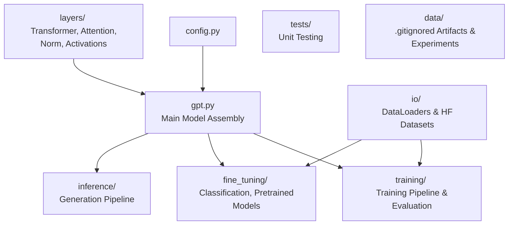

# GPT-2 From Scratch

Implementing GPT-2 from scratch following Build Large Language Model from Scratch [1] by Sebastien Raschka. No coding assisstant has been used during the exercice: it's more instructive and way more fun done this way !

I did not strictly follow the book on two aspects:
- **Code design**: modular, type-annotated, more object oriented at places, and (partially 👀) tested.
- **Datasets**: as detailed below, I chose to use Hugging Face 🤗 datasets for fine tuning.

## Overview

## Fine-Tuning for Classification: Alternative Dataset and Methodology

For this section I deliberately choose to diverge from the book: I will rely on Hugging Face's Open Source
datasets:
- Classification on balanced data: https://huggingface.co/datasets/cornell-movie-review-data/rotten_tomatoes
- Classification on unbalanced data: https://huggingface.co/datasets/Vidushee/iclr-papers-with-code-1k 

### Lessons Learned
- For the classification fine tuning task, left-padding significantly outperformed right-padding.
This might be related to our methodology that only considers the last logits, which would be the pad token
in the right-padded shorter sequences.
- Don't forget to shuffle the training set ! Movies Review dataset stacks all positive reviews together
followed by the negative reviews. The model learned very fast to always output 1 during the first batches,
then the loss exploded as soon as it encountered the negative batches.

### Evaluation Records

#### Movie Reviews

**Notes**: Comparing the Train, Validation, Test results above, we can see that the model
can be overfitting to the training set. This is also visible in the train/validation loss gap evolution. 
It might be interesting to tune the optimizer's weight decay, setup early stopping strategies
or to train on fewer epochs.

#### Fine Tuning Configuration

| Parameter | Value |
|:-----:|:---------:|
| **n_epochs** | 3 |
| **batch_size** | 20 |
| **AdamW learning rate** | 0.001 |

##### Training Set

| Class | Precision | Recall | F1-score | Support |
|:-----:|:---------:|:------:|:--------:|--------:|
| 0 | 0.92 | 0.94 | 0.93 | 4,265 |
| 1 | 0.93 | 0.92 | 0.93 | 4,265 |
| **Accuracy** | | | **0.93** | **8,530** |
| **Macro avg** | **0.93** | **0.93** | **0.93** | **8,530** |
| **Weighted avg** | **0.93** | **0.93** | **0.93** | **8,530** |

|  | Predicted 0 | Predicted 1 |
|:--|-------------:|-------------:|
| Actual 0 | 3,992 | 273 |
| Actual 1 | 357 | 3,908 |

---

##### Validation Set

| Class | Precision | Recall | F1-score | Support |
|:-----:|:---------:|:------:|:--------:|--------:|
| 0 | 0.84 | 0.86 | 0.85 | 533 |
| 1 | 0.86 | 0.83 | 0.85 | 533 |
| **Accuracy** | | | **0.85** | **1,066** |
| **Macro avg** | **0.85** | **0.85** | **0.85** | **1,066** |
| **Weighted avg** | **0.85** | **0.85** | **0.85** | **1,066** |

|  | Predicted 0 | Predicted 1 |
|:--|-------------:|-------------:|
| Actual 0 | 461 | 72 |
| Actual 1 | 90 | 443 |

---

##### Test Set

| Class | Precision | Recall | F1-score | Support |
|:-----:|:---------:|:------:|:--------:|--------:|
| 0 | 0.84 | 0.83 | 0.83 | 533 |
| 1 | 0.83 | 0.85 | 0.84 | 533 |
| **Accuracy** | | | **0.84** | **1,066** |
| **Macro avg** | **0.84** | **0.84** | **0.84** | **1,066** |
| **Weighted avg** | **0.84** | **0.84** | **0.84** | **1,066** |

|  | Predicted 0 | Predicted 1 |
|:--|-------------:|-------------:|
| Actual 0 | 440 | 93 |
| Actual 1 | 82 | 451 |

## References

[1] Raschka, S. (2024). *Build a Large Language Model (From Scratch)*. Manning Publications.
