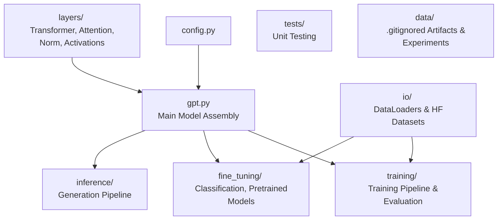

# GPT-2 From Scratch (and Beyond)

Implementing GPT-2 from scratch following Build Large Language Model from Scratch [1] by Sebastien Raschka. No coding assistant has been used during the exercise: it's more instructive and way more fun done this way !

The repo goes beyond the book on these aspects:
- **Code design**: modular, type-annotated, more object oriented at places, and (partially 👀) tested.
- **Datasets**: as detailed below, uses Hugging Face 🤗 datasets for fine tuning.
- **Dependencies**: uses Hugging Face 🤗's `tokenizers` instead of tiktoken.
- **Security**: tensor imports and exports use `safetensors` instead of `pickle`.

## Overview

## Lessons Learned
These are some of the issues that I faced and spent the most time debugging:
- Although the book implements right-padding, for the classification fine tuning task, left-padding significantly outperformed it.
This might be related to our methodology that only considers the last logits, which would be the pad token
in the right-padded shorter sequences.
- Don't forget to shuffle the training set ! Movies Review dataset stacks all positive reviews together
followed by the negative reviews. The model learned very fast to always output 1 during the first batches,
then the loss exploded as soon as it encountered the negative batches.

## Fine-Tuning for Classification: Alternative Dataset and Methodology

For this section I deliberately choose to diverge from the book: I will rely on Hugging Face's Open Source
datasets:
- Classification on balanced data: https://huggingface.co/datasets/cornell-movie-review-data/rotten_tomatoes
- Classification on unbalanced data: https://huggingface.co/datasets/Vidushee/iclr-papers-with-code-1k 

### Evaluation Records

#### Movie Reviews

**Notes**: Comparing the Train, Validation, Test results above, we can see that the model
can be overfitting to the training set. This is also visible in the train/validation loss gap evolution. 
It might be interesting to tune the optimizer's weight decay, setup early stopping strategies
or to train on fewer epochs.

##### Fine Tuning Configuration

| Parameter | Value |
|:-----:|:---------:|
| **n_epochs** | 3 |
| **batch_size** | 20 |
| **AdamW learning rate** | 0.001 |

| Block | Fine Tuned ? |
|:-----:|:---------:|
| **Last Transformer Block** | Yes |
| **Final Norm** | Yes |
| **Output Head** | Yes |

##### Resources

| Device | Duration |
|:-----:|:---------:|
| **GPU T4** | 150.5 s |
| **CPU** | 50m 14s |

##### Memory profiling

This is the snapshot of memory profiling of the first three batches:
- After the first bump, we can see that there is a constant layer that is added. It corresponds to `AdamW`'s state.
- On each batch, we can see the memory grows when activations are computed, then gradients are added. The memory then drops again
as activations that are no longer needed for any gradient are freed, then gradients themselves are freed.
- The spikes in between are typically due to the manual python level implementation of the module's tensor operations.

##### Training Set Metrics

| Class | Precision | Recall | F1-score | Support |
|:-----:|:---------:|:------:|:--------:|--------:|
| 0 | 0.92 | 0.94 | 0.93 | 4,265 |
| 1 | 0.93 | 0.92 | 0.93 | 4,265 |
| **Accuracy** | | | **0.93** | **8,530** |
| **Macro avg** | **0.93** | **0.93** | **0.93** | **8,530** |
| **Weighted avg** | **0.93** | **0.93** | **0.93** | **8,530** |

|  | Predicted 0 | Predicted 1 |
|:--|-------------:|-------------:|
| Actual 0 | 3,992 | 273 |
| Actual 1 | 357 | 3,908 |

---

##### Validation Set Metrics

| Class | Precision | Recall | F1-score | Support |
|:-----:|:---------:|:------:|:--------:|--------:|
| 0 | 0.84 | 0.86 | 0.85 | 533 |
| 1 | 0.86 | 0.83 | 0.85 | 533 |
| **Accuracy** | | | **0.85** | **1,066** |
| **Macro avg** | **0.85** | **0.85** | **0.85** | **1,066** |
| **Weighted avg** | **0.85** | **0.85** | **0.85** | **1,066** |

|  | Predicted 0 | Predicted 1 |
|:--|-------------:|-------------:|
| Actual 0 | 461 | 72 |
| Actual 1 | 90 | 443 |

---

##### Test Set Metrics

| Class | Precision | Recall | F1-score | Support |
|:-----:|:---------:|:------:|:--------:|--------:|
| 0 | 0.84 | 0.83 | 0.83 | 533 |
| 1 | 0.83 | 0.85 | 0.84 | 533 |
| **Accuracy** | | | **0.84** | **1,066** |
| **Macro avg** | **0.84** | **0.84** | **0.84** | **1,066** |
| **Weighted avg** | **0.84** | **0.84** | **0.84** | **1,066** |

|  | Predicted 0 | Predicted 1 |
|:--|-------------:|-------------:|
| Actual 0 | 440 | 93 |
| Actual 1 | 82 | 451 |

## References

[1] Raschka, S. (2024). *Build a Large Language Model (From Scratch)*. Manning Publications.
